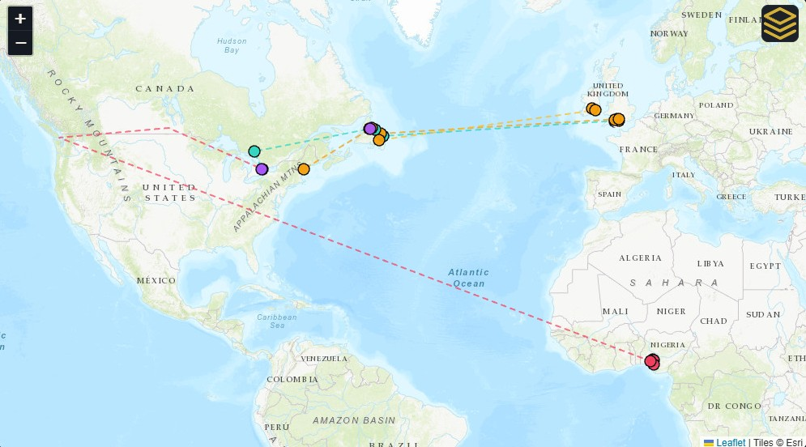

# [UPDATE] Nearly 700 Years of Our Family History: Squires, Akerman, Lush, Lawrence, Goulding, Dwyer, Thorne, Kolade & Ojomu Ancestral Archive (c. 1332–2026)

Self-contained digital historical atlas and UTF-8 text-encoded dataset tracing sixteen documented and reconstructed generations of the Squires, Akerman, Lush, Lawrence, Langdon, Shore, Goulding, Dwyer, and Thorne lineages alongside six generations of the Yorùbá Kolade (Ilé Ọ̀ṣùnkọ́tì) and Ojomu / Ojomo lineages (c. 1332–2026; verified written records 1332–2026).

Spanning West and North Dorset and Somerset (England), County Tipperary and Waterford (Ireland), Emure-Ekiti, Ijebu-Owo, Benin City, Ondo, and Ibadan (Nigeria), Bonavista Bay, Trinity Bay, Notre Dame Bay, and Green Bay outports (Newfoundland), Maine (USA), and Sudbury and Toronto (Ontario, Canada), this archive unites **45 dated primary milestones**, **40 archival series**, and **37 WGS84-mapped ancestral loci**. Transatlantic convergence is anchored in Toronto by **Victor Olusoji Kolade** (1942–2017) of Emure-Ekiti, Nigeria, and **Merle Elizabeth Kolade, née Squires** (1944–2025) of Smith's Harbour, Newfoundland, commemorated at Pine Hills Cemetery, Scarborough (Section A, Lot 2436H). Living Generation 1 birth dates are withheld in this public archival edition.

## Permanent Institutional Vaults & Live Mirror

- **Live Interactive Family Atlas:** [https://kolade-squires-lush.netlify.app/](https://kolade-squires-lush.netlify.app/)
- **CERN Zenodo Concept DOI (All Versions):** [https://doi.org/10.5281/zenodo.24173583](https://doi.org/10.5281/zenodo.24173583)
- **CERN Zenodo Version v2 DOI:** [https://doi.org/10.5281/zenodo.24174537](https://doi.org/10.5281/zenodo.24174537)
- **Internet Archive Collection:** [https://archive.org/details/kolade-squires-lush-archive-1475-2026](https://archive.org/details/kolade-squires-lush-archive-1475-2026)
- **UNESCO Software Heritage Snapshot:** [`swh:1:dir:18e3e023eeb544a1e27c2158aea3db8db957584c`](https://archive.softwareheritage.org/swh:1:dir:18e3e023eeb544a1e27c2158aea3db8db957584c;origin=https://github.com/vickolade/kolade-squires-lush-archive;visit=swh:1:snp:a544ab86c2e3e2065e414780b1f69b5ad697a258;anchor=swh:1:rev:ac6a1a7ab69f0e14cc19dff08f93719426f691f0)

## Open-Standard Preservation Inventory (UTF-8)

- `00_Atlas_World_Map.jpg` — Cartographic overview of the 37 WGS84 ancestral loci and four transatlantic migration corridors.
- `index.html` — Zero-dependency interactive web atlas with compiled CSS, inlined Leaflet 1.9.4 engine, and Natural Earth 1:50m offline world vector basemap.
- `Family_History_Archive_1475_2026.xml` — TEI-XML P5 scholarly edition containing diplomatic transcriptions, `<listBibl>` shelfmarks, `<listPlace>` WGS84 coordinates, and three-tier Genealogical Proof Standard certainty attributes (`high` / `medium` / `low`).
- `Ancestral_Places_WGS84.geojson` — RFC 7946 / Linked Places GIS `FeatureCollection` of 37 ancestral sites, migration corridors, and the September 1544 Arundell three-parish manor grant boundary.
- `Kolade_Squires_Lush_1475_2026.ged` — Sourced 16-generation GEDCOM 7.0 UTF-8 pedigree.
- `Family_History_Timeline_1475_2026.csv` & `Family_History_Data_1475_2026.json` — Tabular CSV and structured JSON datasets.
- `README_ARCHIVAL_MANIFEST.txt` — OAIS / Dublin Core plain-text inventory and evidentiary audit note.

## License

Released under the [Creative Commons Attribution 4.0 International (CC BY 4.0)](https://creativecommons.org/licenses/by/4.0/) license.
